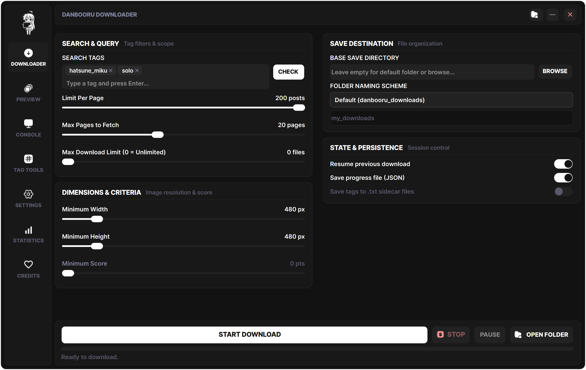
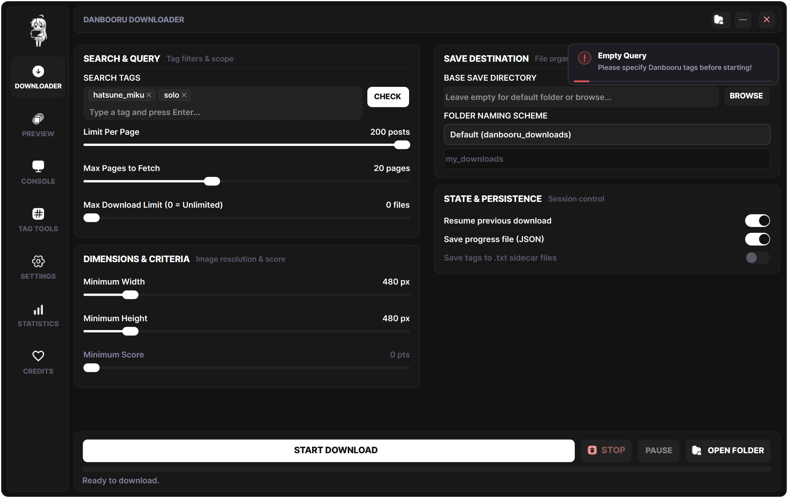
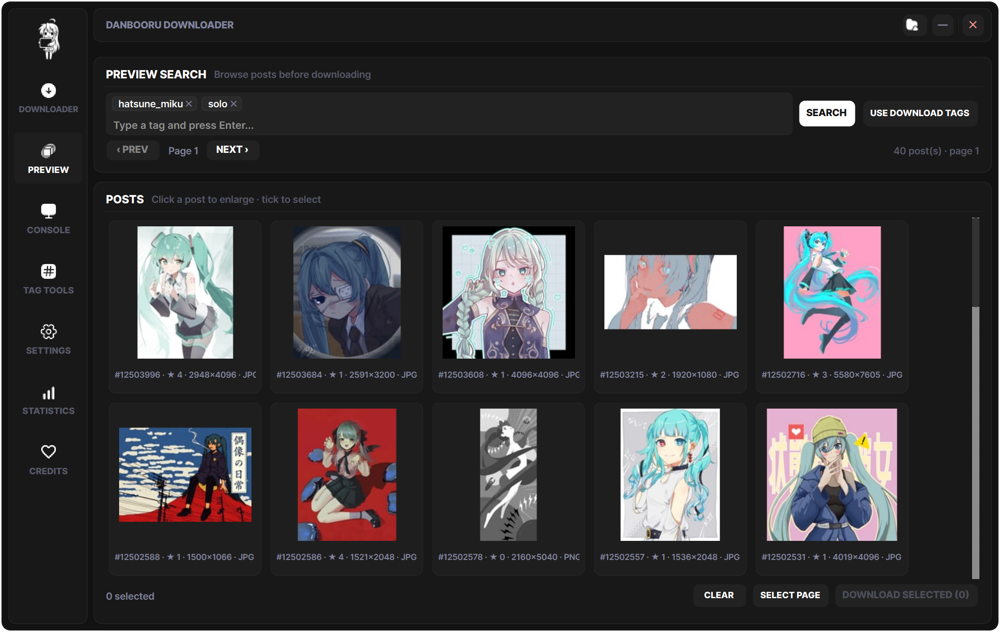
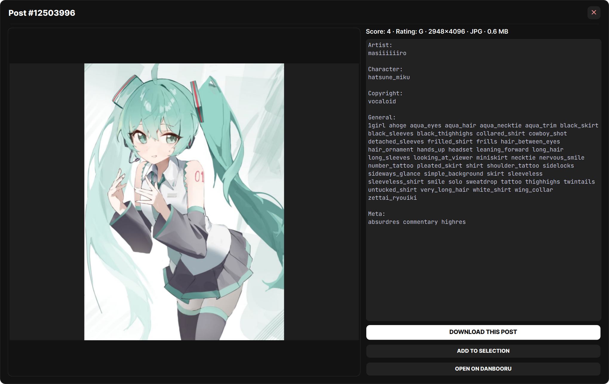
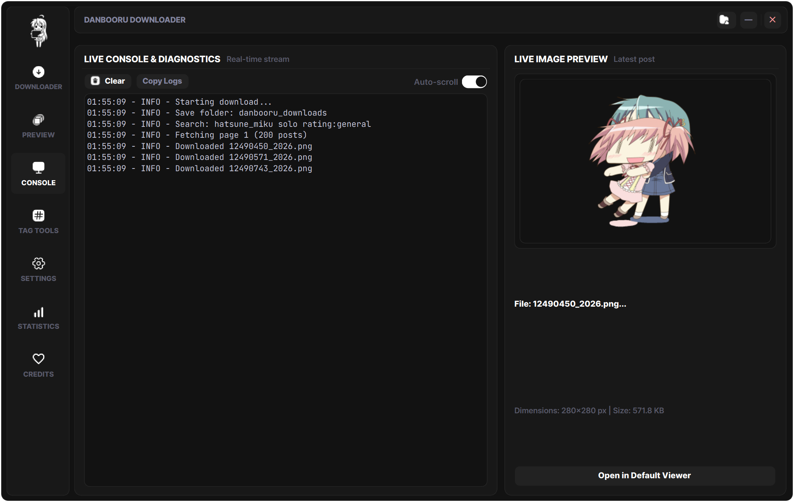
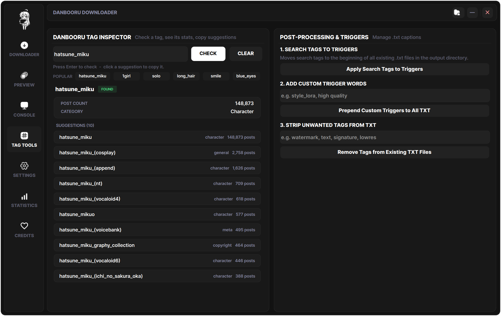
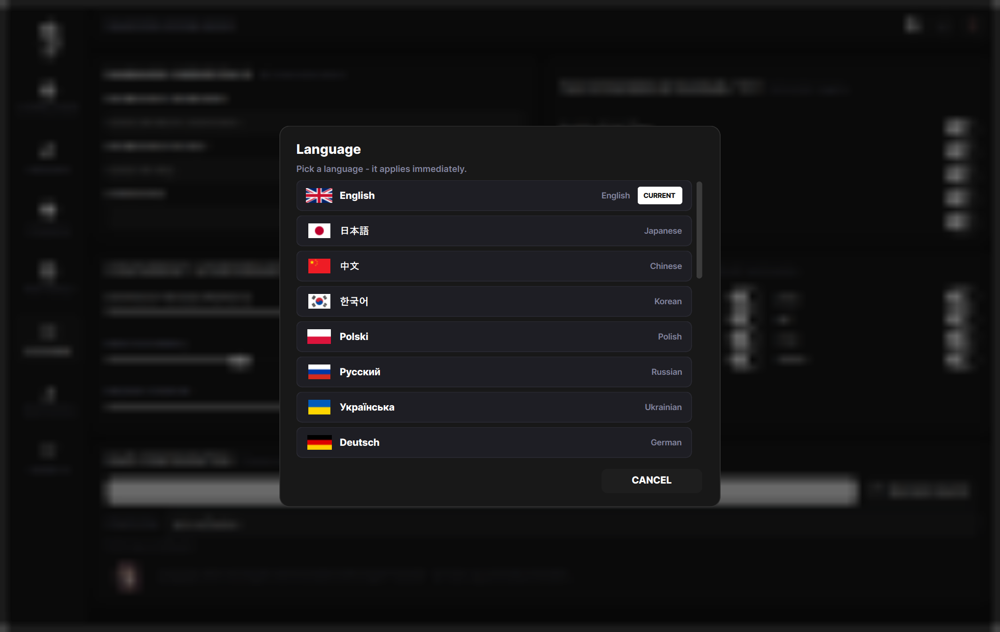
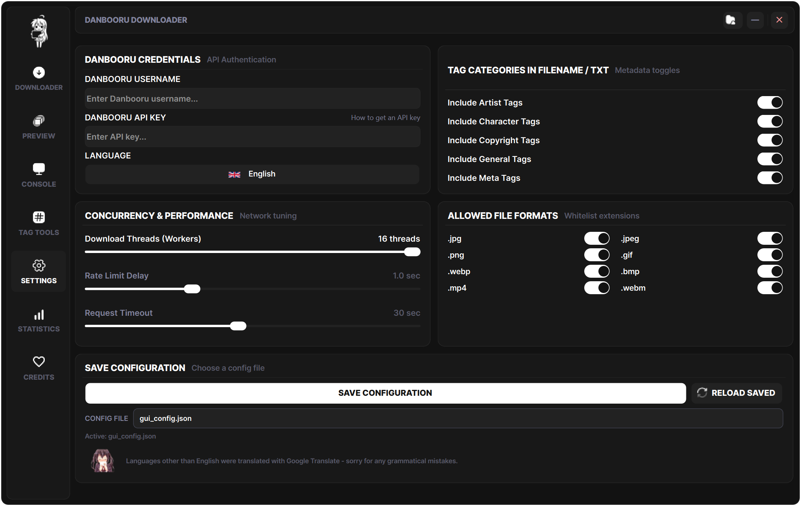
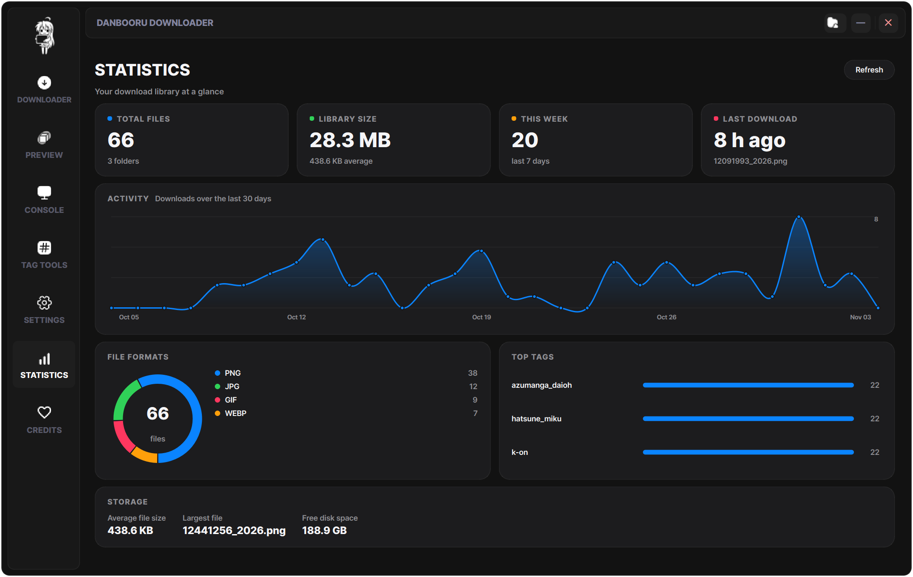

<div align="center">


# SFW Danbooru Downloader


</div>

I wanted a Danbooru downloader that didn't look like a form with a progress
bar glued to it, so I built this. It's a Windows desktop app made with
PySide6, and it only ever downloads SFW posts. That part isn't a setting you
can turn off.

It does the normal downloader stuff well, and then there's a preview browser,
tag tools, statistics, 23 languages and a few things that are just there
because I thought they'd be fun.

> [!TIP]
> Don't want to run Python? Sturdy installer and portable builds live on the
> [Releases page](https://github.com/Acemoneyprod/Safe-for-work-danbooru-downloader/releases/latest).

---

## Downloading

Search works with Danbooru's usual tag syntax. Tags turn into chips, and
toasts keep you posted when something needs your attention.

<p align="center">
  
</p>

> [!IMPORTANT]
> **SFW is hard-locked.** `rating:general` gets added to every query, any
> rating filter you type is ignored, and deleted or banned posts are skipped.
> There's no switch for this.

<p align="center">
  
</p>

You can filter by minimum size and score, set how many posts to fetch per
page, how many pages to walk, and a total download cap. Downloads run in
parallel with a configurable number of workers, plus rate limiting, retries
and timeouts so it doesn't hammer the API.

Pause, resume and cancel all work. If you stop halfway, it can pick up where
it left off and skip the posts you already have.

For saving, you pick a base folder and decide whether folders are named after
the tags, a custom name, or just the default `danbooru_downloads`. Filenames
can include artist, character, copyright, general and meta tags, and you can
drop a `.txt` with the tags next to each image.

The bottom of the downloader tab shows live progress, a rolling file counter
and a preview of the last image that came in.

## Preview

You can look before you download. Posts show up as a thumbnail grid, and the
next pages are fetched in the background so paging doesn't feel like waiting.

<p align="center">
  
</p>

Click a post to see it bigger, along with its score, rating, resolution,
format, size and tags grouped by category. Tick a few posts to select them,
select the whole page, clear the selection, or download only what you picked.
"Use download tags" carries your search over from the downloader tab, and
there's a link to open the post on Danbooru if you want to see it there.

<p align="center">
  
</p>

## Console

The log updates live. You can clear it, copy it, and keep auto-scroll on.
There's also a small preview of the latest downloaded file with its name,
resolution and size.

<p align="center">
  
</p>

## Tag Tools

Type a tag and it shows what kind of tag it is, how many posts use it, a
description, a typo suggestion if you made one, and autocomplete matches.
Click a suggestion to copy it. There's a popular tags list too.

<p align="center">
  
</p>

The bottom part is for people who keep `.txt` files next to their downloads:
you can copy your search tags into trigger words, prepend your own trigger
words, or strip tags out of existing files.

## Settings

Username and API key live here. The key is hidden until you click show, and
there's a link to the wiki page that explains how to get one.

There are 23 languages, with real flag icons: English, Japanese, Chinese,
Korean, Polish, Russian, Ukrainian, German, French, Spanish, Portuguese,
Italian, Dutch, Swedish, Norwegian, Danish, Finnish, Czech, Hungarian,
Romanian, Turkish, Indonesian and Vietnamese. Switching language applies
immediately, no restart.

<p align="center">
  
</p>

You can also change worker count, rate limit and timeout, choose which tag
categories go into filenames and `.txt` files, and toggle the allowed formats
(jpg, png, gif, webp, bmp, mp4, webm). Multiple config files are supported if
you like keeping separate setups.

<p align="center">
  
</p>

In the installed version there are buttons to open the app folder and
uninstall it. Uninstalling asks first, with a blurred confirmation.

## Statistics

This one reads your actual download folder. It shows total files, library
size, how many came in this week, and the last download. There's a 30-day
activity graph, a ring for file formats, bars for your most-used tags, and
storage details like average size, the biggest file and free disk space.

It refreshes when you open the tab and after a download finishes.

<p align="center">
  
</p>

## Running It

You need **Python 3.9** or newer.

- Double-click `gui.py` (a console window flashes away), or
- Double-click `Danbooru Downloader.pyw` (no console at all), or
- From a terminal: `python gui.py`

On the first launch it checks for PySide6, requests and Pillow. If anything is
missing it opens a small installer, downloads the packages with pip and
restarts itself. If that fails because you're offline or pip is blocked, the
window stays open with the log and a retry button.

## Repo Layout

<details>
<summary>Click to expand</summary>

```text
gui.py                  launcher
Danbooru Downloader.pyw launcher with no console
gui_qt.py               main window and pages
welcome.py              startup animation
stats_page.py           statistics page and charts
qt_widgets.py           custom buttons, switches, sliders, chips...
qt_theme.py             colours and fonts
downloader.py           download engine and API
i18n.py                 translation layer
translations.json       23 language strings
res.py                  unpacks resources.dat to a temp folder
resources.dat           packed icons, GIFs, audio and fonts
pack_resources.py       rebuild resources.dat after adding media
bootstrap.py            first-run dependency installer
requirements.txt        PySide6, requests, Pillow
```

</details>

## Where the Media Lives

<details>
<summary>Click to expand</summary>

Icons, GIFs, sounds and fonts are packed into `resources.dat` and unpacked to
`%TEMP%\DanbooruDownloaderResources` when the app starts, so the app folder
stays tidy.

If you want to change something, put the new file in `assets/` or `icons/`,
run `python pack_resources.py`, then delete the loose folder again. The
credits page picks up every `.gif` directly in assets, and the extra credits
pool lives in `assets/credits/` with a small manifest for the random
placement.

The startup animation uses `assets/images/welcome.gif` and
`assets/sounds/app_start.wav`. The toast sounds are `assets/sounds/toast.wav`,
`toast_normal.wav` and `toast_error.wav`.

</details>

> [!IMPORTANT]
> **Strict SFW only.** Every search is hard-locked to `rating:general`.
> Deleted and banned posts are excluded. That's enforced in the query, the
> downloader, the preview gallery and the tag inspector.

## Notes

- Windows only for now.
- The non-English languages were machine-translated, with a handful of hand
  fixes where the result was too weird. The app says so on the settings page.
- Your Danbooru username and API key are not in this repo. The app asks for
  them in Settings and keeps them local. The `gui_config.json` in the repo
  only holds harmless defaults — if you fill in your credentials, don't push
  your own copy.
